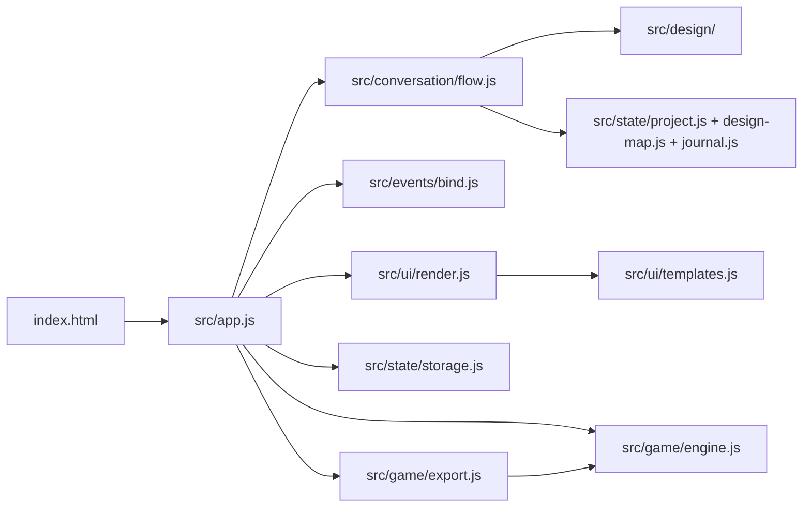

# 代码结构与数据流

这个仓库是原始单文件原型的模块化版本。当前运行在浏览器中，使用 Vite 构建、原生 JavaScript、CSS、Canvas 与 `localStorage`；目前没有 AI 服务或后端。

## 模块职责

- `index.html` 保留页面静态容器和 Vite 入口；中间 Design Map 是常驻主工作区：九个设计元素是同一画布上可拖动、可收起的区块，便签之间用带标签的箭头连接，选中便签时右侧面板显示其连接和受影响的便签，左右 Journal 与 Preview 可独立收起；`src/styles/` 管理三列与手机底部导航布局。
- `src/app.js` 创建项目状态、界面状态、Canvas 引擎和各模块，负责项目切换、撤销、保存与导出。项目对象 `P` 会在加载或新建时替换，依赖方通过 `getProject()` 读取当前对象。
- `src/conversation/flow.js` 管理消息队列、三问开场与第一版草稿、设计地图引导、地图上的增删改、预测、生成、试玩反馈和迭代。第一版草稿生成后立即构建 `v1`，不经过预测问答；之后每次 `Update my game` 都会先预测再生成。切换项目时 `resetProject()` 清除未显示的旧消息、生成定时器和旧引导；生成版本时保存本轮设计要点，收到试玩反馈时写入该版本的评估记录。
- `src/events/bind.js` 把现有 `data-*` 属性、鼠标/触摸指针、键盘与输入事件连接到流程、地图状态和渲染，包括选中与高亮、连接与修改连接标签、拖动区块与便签、平移和缩放；拖动只有在移动超过几个像素后才开始，否则视为点击；新增地图操作时，同时检查模板属性、状态操作与这里的事件分支。
- `src/ui/templates.js` 提供现有 HTML 模板与展示文案；`src/ui/render.js` 把当前项目和 UI 状态映射到 DOM，包括常驻设计地图、Journal 与 Preview 的独立显隐状态。流程决定**何时**渲染，渲染模块决定**如何**呈现。
- `src/design/` 存放设计词库、文本解析和建议选项；`analyze.js` 在本地把开场的自由描述拆成角色、主要动作和按元素分类的机制；`draft.js` 根据三个开场回答和描述生成覆盖九个元素的第一版草稿及默认连接，孩子自己的描述优先于默认值。两者都返回固定结构，将来可替换为 AI 模型；`src/state/project.js` 生成项目状态与游戏配置；`src/state/design-map.js` 同步游戏便签状态，管理便签之间带标签的连接，计算画布布局、选中时的高亮集合（直接相连与后续受影响的便签），并保存区块位置与收起状态；连接的种类就是逻辑贴纸库 `LOGIC_STICKERS` 中的一种（`if → then`、`ends when`、`every 5 s`、`and`、`or`、`unless`、`more → more`、`uses`、`controls`），种类固定、数量不限。`src/state/loops.js` 管理关键行动循环：循环是一组地图上已有便签的 id（保存在 `designMap.loops`，一张便签可在多个循环中），因此两个视图始终一致；便签改写时在循环中换成新 id，删除时从所有循环移除；`suggestLoops()` 为草稿和缺少循环的旧存档按便签作用生成核心、挑战、结束三个循环。循环本身不改变游戏；`if → then`、`ends when` 与 `every 5 s`（引擎每 5 秒触发一次 `tick` 事件）会写成 `when(…)` 规则，其余贴纸在程序中写成“design idea”注释；`src/state/journal.js` 生成 Journal/Assessment 展示数据，并把试玩反思保存到版本；`src/state/storage.js` 集中处理浏览器存储。
- `src/game/program.js` 把设计地图写成一段可读的游戏程序：每张便签对应几行 `game.…()` 设置，每条 `if → then` / `ends when` 箭头在引擎能识别时对应一行 `when(…, then.…())` 规则；引擎本来就会做的连接只写说明，引擎无法识别的连接写成“not in the code yet”。生成版本时运行这段程序得到游戏配置，所以 Code 视图里的程序就是实际运行的代码。`codeFor()` 为选中的便签找出它的程序行、`engine.js` 中对应的行和给孩子的说明。程序还为每行生成一个积木描述（`blocks`），并写出引擎可调的数字（`KNOBS`：物品速度与间隔、跳跃力度、掉落物速度与间隔、追逐者速度、主角速度），默认值等于原引擎的数值；`engine.js` 通过 `kn()` 读取这些可选配置，未设置时与原型完全一致。`src/ui/blocks.js` 把积木描述转成给孩子的文字与可编辑槽位（`SLOTS` 中的数字有上下限，选项来自该元素的建议）。`src/state/code-edit.js` 的 `setCodeValue()` 在 Code 视图中直接修改便签：数字只改该值并同步便签文字中的数字，选项换成对应建议；若便签已在游戏中，则把改动写入一个新的 `byCode` 版本（同一轮代码改动合并为一个版本，可整体撤销）并立即重新载入游戏，不经过对话与竞猜。
- `src/game/engine.js` 是试玩引擎，在原型基础上增加了一个小规则系统：`fire()` 在“被击中”“接到东西”“得分”“失去一条命”时触发，`act()` 执行加速、掉落、追逐者、加分、失去生命、输赢等动作。`tests/baseline-fidelity.test.mjs` 列出了允许改动的原型行，其余原型行必须保持不变。`src/game/export.js` 使用 Vite 的 `?raw` 导入同一份引擎源码，生成可独立运行的游戏 HTML。

## 状态与兼容性

项目数据保存在 `tinkercade.projects.v6`，机器人名称保存在 `tinkercade.bot.v6`。项目包含 `stickers`、`chat`、`versions`、`lastBuilt`、`prediction` 等字段。`versions` 中的 `spec` 用于 Canvas（可含 `rules`），新增的 `program` 保存生成该版本的程序文本，`snapshot` 用于撤销；新增的可选 `journal` 记录该版本的设计便签与预测，`assessment` 记录孩子试玩后的原话、感受和发现。Journal 从版本记录生成，旧版本缺少这些可选字段时会退回使用 `summary`、`items` 和项目中的匹配轮次预测，因此不会要求清除或重写旧 `v6` 存档。`UI` 是当前页面的临时状态，不写入项目 JSON；左右栏显隐和手机当前标签仅保存在内存中。

已有项目继续使用 `tinkercade.projects.v6` 和 `tinkercade.bot.v6` 键名。恢复项目时，`src/state/project.js` 为缺少 `designMap` 的旧条目从现有便签生成初始卡片，并保留游戏配置所需的原始字段。`designMap` 是附加字段，包含游戏便签节点、`edges` 连接和可选的 `clusters`（各元素区块的位置与收起状态）。连接可以在同一元素内或跨元素，带 `label`（`then`、`uses`、`controls`、`ends`），不能自连或重复；没有 `label` 的旧连接按 `then` 显示。编辑便签时节点 id 保持不变，所以连接会保留，删除便签时相关连接一并移除。便签新增可选字段 `by`（`ai` 为草稿，`kid` 为孩子的想法）和 `replaces`（改写前已构建的便签 id，用于把一次改写只算作一处待更新改动）。确认步骤已取消：恢复项目时，旧存档中 `status: "new"` 的便签改为 `ok`。`if → then` 与 `ends when` 连接经 `program.js` 变成游戏规则；作为规则目标的“开关型”便签（加速、掉落、追逐者）不再一开始就生效，而是等规则触发。`uses`、`controls` 只是设计说明。待更新改动除了便签，还包括与上一版本程序相比新增或删除的 `when(…)` 行。旧存档中的自由规划便签仍原样保存，但不再显示在地图上。

修改存储结构前，应先增加旧数据兼容测试，并在项目模块中实现迁移或兼容读取。不要更改 `v6` 键名，也不要让地图布局数据进入 `buildProjectSpec()` 生成的游戏规则。

## 构建产物

`npm run build` 生成 `dist/index.html`，供静态网站服务器部署；同时生成 `dist/standalone-preview.html`，供本机直接双击预览。两者都由同一份源码构建。`dist/` 不提交到仓库。游戏面板的 `Export HTML` 则导出**当前项目游戏**的独立 HTML，与整站预览文件用途不同。

`baseline/source/Tinker 550.html` 是原始文件的逐字节副本。`tests/baseline-fidelity.test.mjs` 检查基准哈希、静态页面结构、样式及 Canvas 引擎是否与原型一致；有意改版时应在代码评审中说明并相应调整验收基准。
