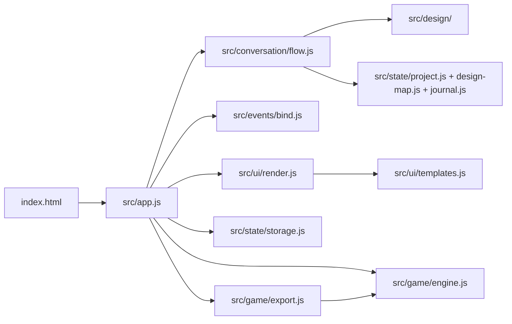

# 代码结构与数据流

这个仓库是原始单文件原型的模块化版本。当前运行在浏览器中，使用 Vite 构建、原生 JavaScript、CSS、Canvas 与 `localStorage`；目前没有 AI 服务或后端。

## 模块职责

- `index.html` 保留页面静态容器和 Vite 入口；中间 Design Map 是常驻主工作区，左右 Journal 与 Preview 可独立收起；`src/styles/` 管理三列与手机底部导航布局。
- `src/app.js` 创建项目状态、界面状态、Canvas 引擎和各模块，负责项目切换、撤销、保存与导出。项目对象 `P` 会在加载或新建时替换，依赖方通过 `getProject()` 读取当前对象。
- `src/conversation/flow.js` 管理消息队列、设计地图引导、便签确认、预测、生成、试玩反馈和迭代。切换项目时 `resetProject()` 清除未显示的旧消息、生成定时器和旧引导；生成版本时保存本轮设计要点，收到试玩反馈时写入该版本的评估记录。
- `src/events/bind.js` 把现有 `data-*` 属性、鼠标/触摸指针、键盘与输入事件连接到流程、地图状态和渲染。拖动地图卡片只在移动结束时保存；新增画布工具时，同时检查模板属性、状态操作与这里的事件分支。
- `src/ui/templates.js` 提供现有 HTML 模板与展示文案；`src/ui/render.js` 把当前项目和 UI 状态映射到 DOM，包括常驻设计地图、Journal 与 Preview 的独立显隐状态。流程决定**何时**渲染，渲染模块决定**如何**呈现。
- `src/design/` 存放设计词库、文本解析和建议选项；`src/state/project.js` 生成项目状态与游戏配置；`src/state/design-map.js` 管理自由画布规划节点、位置、连接，并同步游戏便签状态；`src/state/journal.js` 生成 Journal/Assessment 展示数据，并把试玩反思保存到版本；`src/state/storage.js` 集中处理浏览器存储。
- `src/game/engine.js` 是试玩引擎。`src/game/export.js` 使用 Vite 的 `?raw` 导入同一份引擎源码，生成可独立运行的游戏 HTML。

## 状态与兼容性

项目数据保存在 `tinkercade.projects.v6`，机器人名称保存在 `tinkercade.bot.v6`。项目包含 `stickers`、`chat`、`versions`、`lastBuilt`、`prediction` 等字段。`versions` 中的 `spec` 用于 Canvas，`snapshot` 用于撤销；新增的可选 `journal` 记录该版本的设计便签与预测，`assessment` 记录孩子试玩后的原话、感受和发现。Journal 从版本记录生成，旧版本缺少这些可选字段时会退回使用 `summary`、`items` 和项目中的匹配轮次预测，因此不会要求清除或重写旧 `v6` 存档。`UI` 是当前页面的临时状态，不写入项目 JSON；左右栏显隐和手机当前标签仅保存在内存中。

已有项目继续使用 `tinkercade.projects.v6` 和 `tinkercade.bot.v6` 键名。恢复项目时，`src/state/project.js` 为缺少 `designMap` 的旧条目从现有便签生成初始卡片，并保留游戏配置所需的原始字段。`designMap` 是附加字段，包含规划节点、游戏便签关联和 `edges` 连线；节点位置和自由便签随项目保存，连接不能自连或重复。关联游戏便签的状态为 `idea`、`confirmed`、`built`，独立规划便签只作为计划，不进入 `buildProjectSpec()` 生成的游戏规则。

修改存储结构前，应先增加旧数据兼容测试，并在项目模块中实现迁移或兼容读取。不要更改 `v6` 键名，也不要让地图布局数据进入 `buildProjectSpec()` 生成的游戏规则。

## 构建产物

`npm run build` 生成 `dist/index.html`，供静态网站服务器部署；同时生成 `dist/standalone-preview.html`，供本机直接双击预览。两者都由同一份源码构建。`dist/` 不提交到仓库。游戏面板的 `Export HTML` 则导出**当前项目游戏**的独立 HTML，与整站预览文件用途不同。

`baseline/source/Tinker 550.html` 是原始文件的逐字节副本。`tests/baseline-fidelity.test.mjs` 检查基准哈希、静态页面结构、样式及 Canvas 引擎是否与原型一致；有意改版时应在代码评审中说明并相应调整验收基准。
